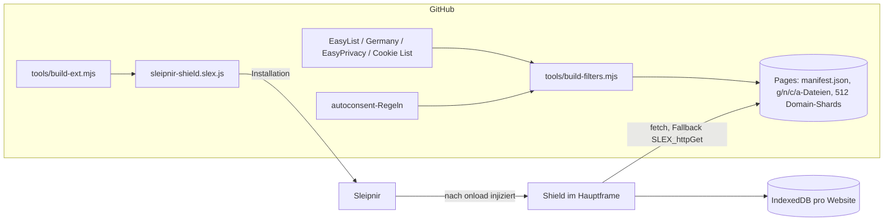

# Shield für Sleipnir Mobile (Android)

Werbe- und Trackerblocker als Sleipnir-Extension, mit automatischer Ablehnung von Cookie-Bannern.

- **Werbung ausblenden**: EasyList und EasyList Germany als Ausblendregeln, generisch und seitenspezifisch, dazu die seitenspezifischen Regeln aus Fanboy's Annoyance List (z. B. „In der App öffnen“-Banner).
- **Anfragen blockieren**: Skripte, iFrames, Bilder/Pixel, `fetch`, XHR, `sendBeacon`, WebSocket und Pop-ups zu ~60 000 Werbe- und Tracker-Hosts (EasyList, EasyPrivacy) sowie getarnte Tracker-Subdomains (CNAME-Listen) auf ihrer eigenen Seite.
- **Cookie-Banner ablehnen**: [DuckDuckGo autoconsent](https://github.com/duckduckgo/autoconsent) mit über 1 500 CMP-Regeln (OneTrust, Cookiebot, Usercentrics, Didomi, consentmanager, Sourcepoint, Borlabs …) und einer Heuristik für unbekannte Banner. Geklickt wird nur „Ablehnen“, „Nur notwendige“ oder bei reinen Hinweisen „OK“, **nie „Akzeptieren“**. Banner, die sich nicht ablehnen lassen, werden mit der EasyList Cookie List ausgeblendet und das Scrollen wird wieder freigegeben.
- **Anti-Adblock-Hinweise** („Kein Bock auf Werbung?“) werden samt Abdunklung und Scroll-Sperre entfernt.
- **Automatische Updates**: GitHub Actions baut täglich frische Filter; die Extension lädt sie selbst nach.
- **Ausnahmen**: pro Seite über den Schild-Knopf, global über `config/allowlist.txt`.

## Einrichtung (einmalig, ca. 10 Minuten)

Die Filter werden auf GitHub Pages gehostet, denn Sleipnir-Extensions haben keinen geräteweiten Speicher. Jede Website hat ihren eigenen Cache, und vorkompilierte, nach Domains aufgeteilte Filter halten den Download klein.

1. Repository: [Slothinger/Sleipnir-Adblock](https://github.com/Slothinger/Sleipnir-Adblock) (muss **öffentlich** sein, damit Pages kostenlos läuft).
2. Im Repository: **Settings → Pages → Source: GitHub Actions**.
3. **Actions → „Filter und Extension bauen“ → Run workflow**. Danach liegt alles unter <https://slothinger.github.io/Sleipnir-Adblock/>.
4. Diese Adresse **in Sleipnir** öffnen und auf „In Sleipnir installieren“ tippen (oder direkt <https://slothinger.github.io/Sleipnir-Adblock/sleipnir-shield.slex.js> öffnen). Sleipnir zeigt den Installationsdialog.
5. Den eingebauten Sleipnir-Werbeblocker eingeschaltet lassen. Für Blockieren schon **vor** dem Laden siehe [Grenzen](#grenzen).

Die Filter-Adresse ist beim Bauen fest in die Extension eingetragen. Nach einem Wechsel von Repository oder Benutzername die Extension neu installieren.

## Bedienung

Am linken Rand sitzt ein kleiner blauer **Schild-Knopf**; die Zahl zeigt blockierte Anfragen. Antippen öffnet das Panel:

| Funktion | Wirkung |
|---|---|
| Werbeblocker auf dieser Seite | Aus = Ausnahme für diesen Host (z. B. wenn eine Seite kaputt ist) |
| Cookie-Banner automatisch ablehnen | Aus = Banner auf dieser Seite selbst bedienen |
| Element ausblenden | Element antippen, mit „Größer/Kleiner“ anpassen, „Ausblenden“ speichert eine Regel für diese Seite |
| Ausgeblendetes prüfen | listet die Regeln, die hier gerade etwas verstecken; „Zulassen“ zeigt das Element auf dieser Seite wieder |
| Filter aktualisieren | lädt Filter sofort neu statt nach spätestens 6 Stunden |

Ausnahmen pro Seite liegen im `localStorage` der jeweiligen Seite. Wer dort die Website-Daten löscht, löscht auch die Ausnahmen.

### Globale Einstellungen (im Repository, gelten für alle Geräte)

| Datei | Inhalt |
|---|---|
| `config/allowlist.txt` | Domains, auf denen Shield aus ist; `domain ads` oder `domain cookies` schaltet nur eine Funktion ab |
| `config/userfilters.txt` | eigene Regeln in EasyList-Syntax (`example.com##.banner`, `\|\|host^`, `@@\|\|host^` …) |
| `config/lists.json` | Filterlisten an/aus. Fanboy's Annoyance List ist nur mit seitenspezifischen Regeln aktiv (`"specificOnly": true`: App-Banner, Newsletter-Popups, Chat-Widgets einzelner Seiten), damit die allgemeine Datei klein bleibt; uBlock filters ist vorbereitet, aber aus |
| `config/settings.json` | `ads`, `network`, `cookies`, `button` global an/aus |

Nach dem Commit baut der Workflow neu. Die Extension holt die Änderung spätestens nach 6 Stunden pro Website, sofort über „Filter aktualisieren“.

## Funktionsweise



- **Pro Seitenaufruf** liest Shield `manifest.json` aus dem Cache (alle 6 h neu), die allgemeinen Dateien (Ausblendregeln ≈60 KB, Host-Liste ≈135 KB, autoconsent ≈55 KB, jeweils gzip) und den einen Shard der Domain (≈2 KB). Die großen Dateien werden pro Website nur alle 2–3 Tage erneuert. Die Cookie-Ausblendliste (≈75 KB) wird nur geladen, wenn ein Banner nicht abgelehnt werden konnte.
- **Ausblenden** läuft über konstruierbare Stylesheets (`adoptedStyleSheets`); die Content-Security-Policy der Seite greift dort nicht. Die Oberfläche läuft in einem geschlossenen Shadow-DOM ohne `innerHTML` und ist damit auch mit Trusted Types verträglich.
- **Blockieren** über Proxys auf `fetch`, `XMLHttpRequest`, `sendBeacon`, `WebSocket`, `window.open`, die `src`-Setter von Skripten, iFrames, Bildern und Embeds, `setAttribute` sowie einen MutationObserver. `toString()` liefert weiter `[native code]`. Anfragen an die eigene Website werden nie blockiert, außer an bekannte CNAME-Tracker.
- Sleipnir führt Extensions per `WebView.loadUrl("javascript:…")` aus. Chromium entfernt dabei alle Zeilenumbrüche und Tabs und dekodiert jedes `%XX`. Der Build erzeugt deshalb eine einzige Zeile ohne Kommentare, ersetzt `%XX` in Literalen durch `\x25XX` und bricht ab, falls doch etwas übrig bleibt; `npm run test:e2e` injiziert genau auf diesem Weg.

## Grenzen

- **Sleipnir startet Extensions erst nach `window.onload`** (Quelle: Sleipnir-Entwicklerdoku, bestätigt im APK). Werbung, die beim ersten Laden kommt, ist also schon geladen und wird nur ausgeblendet. Blockiert werden erst später geladene Inhalte (Lazy-Loading, Ad-Refresh, Tracking-Beacons, Pop-ups). Für echtes Blockieren ab der ersten Anfrage zusätzlich in Android **Einstellungen → Verbindungen → Weitere Verbindungseinstellungen → Privates DNS** z. B. `dns.adguard-dns.com` eintragen.
- **Nur der Hauptframe**: Sleipnir injiziert nicht in iFrames. Cookie-Dialoge in fremden iFrames (Sourcepoint auf vielen deutschen Nachrichtenseiten, teilweise TrustArc) lassen sich nicht anklicken. Sie werden ausgeblendet und das Scrollen wird freigegeben. Seiten, die ohne Zustimmung gar keinen Inhalt liefern („Zustimmen oder Abo“, z. B. derstandard.at), stehen mit `cookies` in `config/allowlist.txt`: dort einmal selbst zustimmen, die Werbung blockiert Shield trotzdem.
- **Kein geteilter Speicher**: Jede Website lädt die Filter beim ersten Besuch selbst (≈250 KB). Auf Seiten, deren CSP `fetch` zu GitHub verbietet, nutzt Shield `SLEX_httpGet`; das blockiert die Seite kurz, bis der Download fertig ist. Der Cache belegt pro besuchter Website rund 0,7 MB in IndexedDB; bei Speicherknappheit räumt der Browser selten genutzte Websites selbst ab.
- **Host-genaues Blockieren**: Pfadregeln wie `||example.com/ads/` werden nicht als Anfrageblock umgesetzt. Erfasst sind ganze Hosts, und die meiste Werbung hängt an eigenen Hosts. Erweiterte uBlock-Syntax (Scriptlets, `:has-text`, `:style`) wird übersprungen; ABP-`:-abp-has()` wird zu nativem `:has()`.
- GitHub pausiert geplante Workflows nach 60 Tagen ohne Commits im Repository (kommt per Mail). Dann unter Actions wieder aktivieren oder einen beliebigen Commit pushen.
- Sleipnir aktualisiert nur Extensions aus der Extensions Gallery selbst. Neue **Code**-Versionen von Shield (nicht Filter) installierst du, indem du die `.slex.js` erneut öffnest; `@origin` sorgt dafür, dass die alte Version ersetzt wird.

## Entwicklung

```sh
npm ci
npm test                      # Compiler, Shards, Matcher, Escaping
npm run test:e2e              # echte Listen + gebaute Extension in mobilem Chromium mit Sleipnir-Wrapper
node tools/build-filters.mjs  # -> public/f/
node tools/build-ext.mjs --base http://127.0.0.1:8080/
```

`test:e2e` liest Listen aus `.cache/lists/<id>.txt` (wenn vorhanden) und braucht Chromium (`SHIELD_CHROME=/pfad/zu/chrome`, sonst Playwright-Cache).

## Lizenzen

Code: MPL-2.0. Enthält [@duckduckgo/autoconsent](https://github.com/duckduckgo/autoconsent) (MPL-2.0). Die Filterdaten stammen aus [EasyList](https://easylist.to/) (GPLv3 / CC BY-SA 3.0) und werden nur umformatiert.
